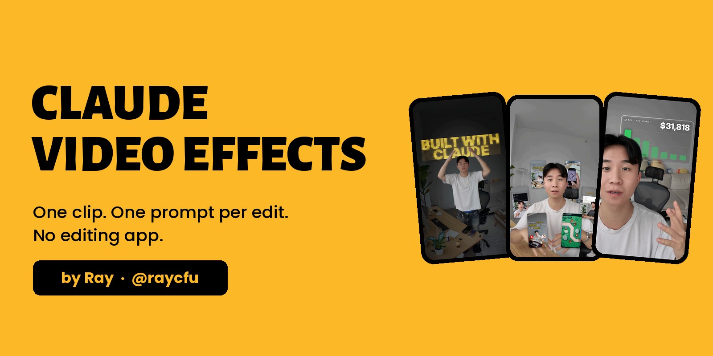
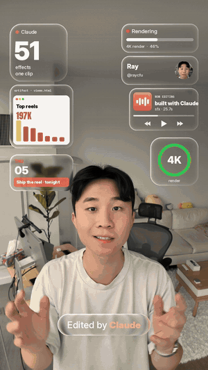
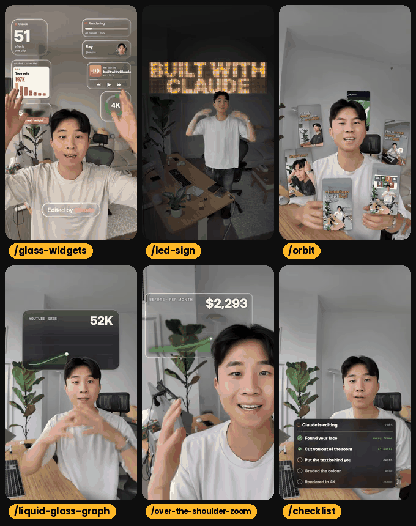
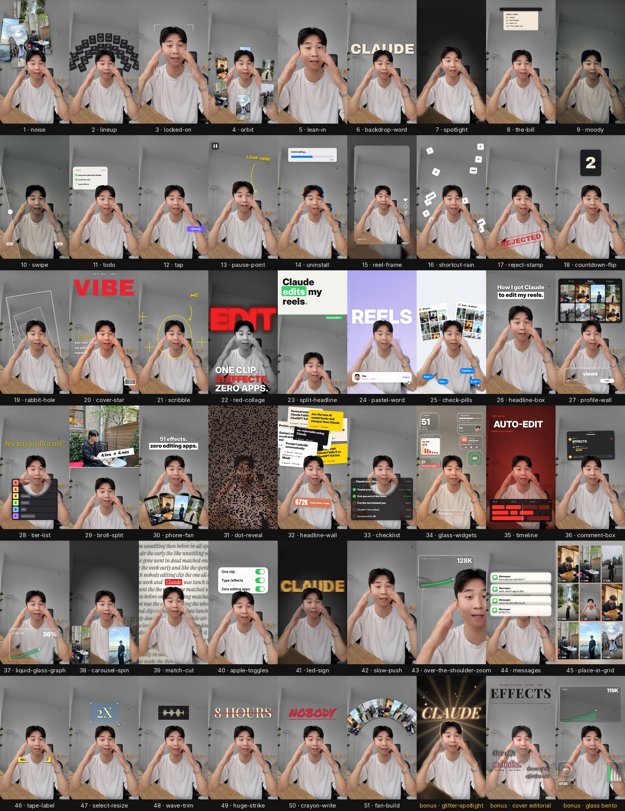

<p align="center">
  
</p>

<h1 align="center">Claude Video Effects</h1>

<p align="center">
  <b>Film one clip. Type one command. Get the edit.</b><br>
  51 video effects and a viral reel builder for Claude Code. No editing app.
</p>

<p align="center">
  <a href="#install"></a>
  <a href="#the-51-effects"></a>
  <a href="https://docs.anthropic.com/en/docs/claude-code"></a>
  <a href="LICENSE"></a>
</p>

<p align="center">
  <a href="#install">Install</a> ·
  <a href="#your-first-video-in-3-steps">First video</a> ·
  <a href="#the-51-effects">All 51 effects</a> ·
  <a href="#the-reel-builder">Reel builder</a> ·
  <a href="#if-something-goes-wrong">Help</a> ·
  <a href="https://skool.com/raycfu">Community</a>
</p>

---

<table>
<tr>
<td width="62%" valign="top">

### Hey, I'm Ray 👋

I spent five years as a software engineer at Meta, then left to build with AI full-time.

I filmed one clip of myself talking, opened Claude Code, and typed `/effects orbit`. My own reels started circling my head. Then `/effects led-sign`, `/effects checklist`, `/effects liquid-glass-graph`. Every edit in that reel came from a prompt.

This repo is that exact kit, cleaned up so you can do the same in about two minutes.

**What you get**
- **51 effects** that track your face and put graphics behind your head
- **A reel builder** that turns your edits into the "I typed a command and Claude edited my video" format
- **One-command install** for Mac, Windows and Linux

</td>
<td width="38%" align="center" valign="top">
  
  <br><sub>The reel this kit made</sub>
</td>
</tr>
</table>

> [!TIP]
> **Don't want to figure this out alone?** I walk members through every step inside the community. **[Join the Skool → skool.com/raycfu](https://skool.com/raycfu)**

---

## Install

**Easiest, on any computer.** Open Claude Code and paste:

```
Install everything from github.com/raycfu/claude_design_skills by cloning it and running its installer
```

Claude installs whatever is missing for you.

<details>
<summary><b>Prefer the terminal?</b> Mac, Linux and Windows commands</summary>

<br>

**Mac / Linux**

```bash
git clone https://github.com/raycfu/claude_design_skills ~/raycfu-video-kit
bash ~/raycfu-video-kit/install.sh
```

**Windows (PowerShell)**

```powershell
git clone https://github.com/raycfu/claude_design_skills $HOME\raycfu-video-kit
powershell -ExecutionPolicy Bypass -File $HOME\raycfu-video-kit\install.ps1
```

**What it needs:** Claude Code, ffmpeg, Python 3.10 to 3.13 (3.12 is safest) and git.

| | Mac | Windows | Linux |
|---|---|---|---|
| ffmpeg | `brew install ffmpeg` | `winget install ffmpeg` | `sudo apt install ffmpeg` |
| Python | `brew install python@3.12` | `winget install Python.Python.3.12` | `sudo apt install python3 python3-venv` |
| git | `xcode-select --install` | `winget install Git.Git` | `sudo apt install git` |

The installer prints `READY` when it's done (about 2 minutes the first time). Restart Claude Code afterwards.

**Update later:** `git -C ~/raycfu-video-kit pull`, then run the installer again. Your setup is kept.

</details>

---

## Your first video in 3 steps

| | |
|---|---|
| **1. Film** | Yourself talking, vertical, 5 to 30 seconds. Leave a little space above your head. |
| **2. Type** | Drag the video into Claude Code and type `/effects orbit from 1 to 4 seconds` |
| **3. Post** | Claude shows you a still frame first, then saves `yourvideo_effects.mp4` next to your original, audio kept. |

Stack as many as you want in one message:

```
Add glass-widgets from 0 to 3s, then orbit from 3 to 6s, then a checklist on "here's what it did"
```

---

## My six

These six made my reel. Each one is a single prompt.

<p align="center">
  
</p>

```
/effects glass-widgets from 0.3s, big number 51 "effects", handle @yourhandle
/effects led-sign at 0.4s with BUILT WITH|CLAUDE in yellow, slow push in
/effects orbit using the clips in ./reels, 6 cards, play=1 so each clip plays inside its card
/effects liquid-glass-graph with pos=behind, YOUTUBE SUBS from 12K to 100K
/effects over-the-shoulder-zoom, Before $3,200 per month, After $32,000 per month
/effects checklist titled "Claude is editing", 5 steps, last tick when I raise my hands
```

---

## The 51 effects

<p align="center">
  
</p>

**Around your head**
`orbit` `carousel-spin` `fan-build` `noise` `lineup` `glass-widgets` `scribble` `shortcut-rain` `countdown-flip` `todo`

**Behind you**
`spotlight` `led-sign` `backdrop-word` `pastel-word` `red-collage` `huge-strike` `crayon-write` `match-cut` `headline-wall` `cover-star`

**Cards, UI and data**
`checklist` `liquid-glass-graph` `over-the-shoulder-zoom` `comment-box` `messages` `apple-toggles` `tap` `the-bill` `uninstall` `tier-list` `check-pills` `profile-wall` `phone-fan` `place-in-grid` `select-resize` `tape-label` `headline-box` `split-headline` `timeline` `broll-split` `reel-frame` `wave-trim` `pause-point` `reject-stamp`

**Camera and grade**
`locked-on` `lean-in` `slow-push` `moody` `swipe` `rabbit-hole` `dot-reveal`

**Bonus looks:** `glitter-spotlight` · `cover-star look=editorial` · `liquid-glass-graph look=bento`

What each one does: **[effects/README.md](effects/README.md#the-51-effects)** · Every option: **[effects/SKILL.md](effects/SKILL.md)**

---

## The reel builder

Wrap your edits in the format that's everywhere right now: a chat screen types `/orbit`, the edit builds out of glowing dots, zooms full screen, and the reel ends on a **Comment "EFFECT"** grid of your edits.

```
/reel-builder use these 6 clips, comment word EFFECT, open on the orbit clip
```

- Cold open, typing, dot builds, 2-second full-screen hits and the end grid, all drawn in code
- Keyboard typing sounds only, so you lay your own music on top
- Exports the reel, a silent copy and the typing track as a WAV

Details: **[reel-builder/SKILL.md](reel-builder/SKILL.md)**

---

## Why this version looks better

When I ran the starter effects on my own footage, a lot of first renders looked off. This is what I rebuilt:

| Before | Now |
|---|---|
| Soft, flickery cutout around hair and hands | Robust Video Matting cutout, clean edges, no flicker |
| Frosted glass smeared a blurry copy of your body | Dark smoked glass option, always readable |
| Checklist cut a bright hole around your chin | Smaller card sitting low, never touches your face |
| Orbit cards showed still screenshots | `play=1` plays your actual clips inside the cards |
| Graph sat on top of your chest | `pos=behind` puts it on a glass screen behind your head |
| `$32,000` counted up as `32000` | Currency signs and commas count up properly |
| Icons that looked like another brand's logo | Clean spinner and waveform icons |
| Effects fired before your gesture | Timing options so the payoff lands on your move |

---

## Filming tips that decide whether it looks good

- **Film for the effect.** Point up only where a sign will appear. Open your hands where widgets pop.
- **Keep your hands low and still** where a card sits at your chest, then raise them on the payoff.
- **Leave headroom.** Anything big lives above your head.
- **Shoot vertical**, 4K if you can, camera still.
- **Check your mic** is actually recording.
- **Ask for stills first** and say exactly what looks off before the full render.

---

## If something goes wrong

Tell Claude what you see in plain words ("the text covers my face", "it's too fast"). It fixes the plan and renders again.

<details>
<summary><b>Common messages and fixes</b></summary>

<br>

| You see | What to do |
|---|---|
| `NEED_FFMPEG` | Install ffmpeg (see Install), then run the installer again |
| `NEED_PYTHON` or `NEED_PYTHON_312` | Install Python 3.12, then run the installer again |
| `/effects` does nothing | Restart Claude Code so it loads the new skills |
| Text or cards cover your face | Say so. Claude moves them or puts them behind your head |
| The cutout looks soft around your hair | Run the installer again so it can download the cleaner cutout model |
| Lots of `WARNING` / `INFO` lines | Normal. Only `Done:` means the render finished |
| Effect lands at the wrong moment | Say the moment in words ("when I say 'watch'") and Claude finds the second |
| Rendering feels slow | It runs on your computer's processor. Keep each effect to 2 to 4 seconds |

</details>

<details>
<summary><b>FAQ</b></summary>

<br>

**Is it free?** Yes. MIT licensed. Use it for your own content and for clients.

**Do I need to code?** No. You talk to Claude in plain English. It runs everything.

**Does it upload my video anywhere?** No. Everything renders on your own computer.

**Can I use my own reels and numbers?** Yes. Give Claude a folder of screenshots or clips, and tell it your real numbers for charts and counters.

**Does it add music?** No, on purpose. Add your own track so your reel isn't one of a thousand with the same sound.

</details>

---

## Credits and licenses

`effects/` and `reel-builder/` are MIT licensed: see [LICENSE](LICENSE) and [effects/LICENSE](effects/LICENSE). Robust Video Matting (GPL-3.0) is downloaded during setup and not included. Fonts are under the SIL Open Font License or Apache 2.0 ([effects/fonts](effects/fonts)). Model notices: [effects/models/NOTICE.md](effects/models/NOTICE.md).

---

<p align="center">
  
</p>

<p align="center">
  I post practical AI builds every week. If this saved you an editor, come say hi.
</p>

<p align="center">
  <a href="https://youtube.com/@raycfu"></a>
  <a href="https://instagram.com/raycfu"></a>
  <a href="https://x.com/rayycfu"></a>
  <a href="https://tiktok.com/@ray_fu"></a>
  <a href="https://skool.com/raycfu"></a>
</p>

<p align="center">
  <b>Don't want to figure this out alone? <a href="https://skool.com/raycfu">Join the Skool → skool.com/raycfu</a></b>
</p>
